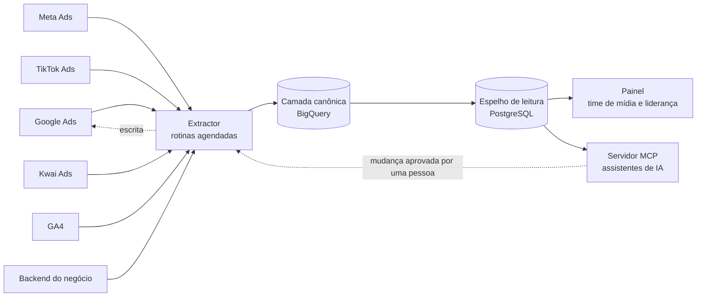
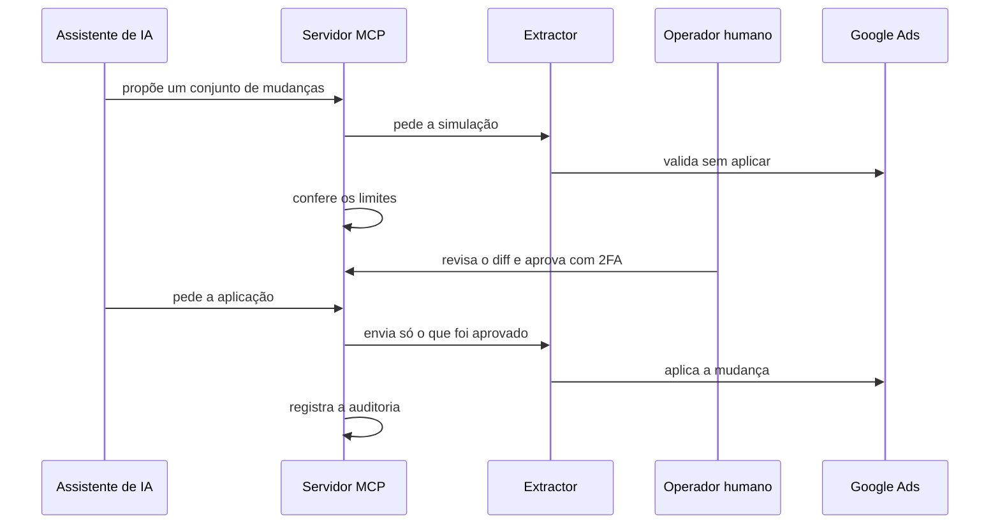

# Plataforma de inteligência de aquisição: arquitetura

Como eu estruturo uma plataforma que junta investimento em mídia, resultado de negócio e dados de navegação numa fonte única, e que deixa assistentes de IA operarem campanhas com aprovação humana.

Este repositório descreve a arquitetura. O código é privado e eu mostro numa conversa.

## O problema

Cada fonte conta uma história diferente. A plataforma de anúncio reporta as conversões dela, o backend do negócio registra cadastros e compras, e o GA4 mede sessões. Sem uma camada comum, cada tela mostra um número, o time discute qual está certo e a decisão de escalar ou cortar acaba saindo do resultado do dia.

## Visão geral

## Três serviços, três responsabilidades

| Serviço | Responsável por | Quem usa |
| --- | --- | --- |
| Extractor | Ingestão das fontes, tabelas canônicas, checagens de qualidade e execução de escrita no Google Ads | Roda sozinho, em rotinas agendadas |
| Painel | Telas de aquisição, metas, pacing, cohort e tracking | Time de mídia e liderança |
| Servidor MCP | Contrato para IA: ferramentas de leitura e o plano de controle das mudanças | Assistentes de IA, sob supervisão de um operador |

A separação é proposital. O painel não agenda nada: toda sincronização vive no extractor. O servidor MCP não guarda credencial de plataforma de anúncio: quem escreve é o extractor, e só depois de uma aprovação humana.

## Camada canônica: um número por conceito

- **Performance diária**: uma tabela no grão data, plataforma e campanha, que junta mídia, resultado de negócio e GA4.
- **Cohort**: uma base por data da primeira compra, que acompanha a maturação do grupo (D0, D1, D7, D30 em diante). Decisão de escala usa dado maduro.
- **Atribuição em fonte única**: uma view com a cascata inteira, consumida por todas as telas.
  1. Casamento com a campanha de mídia.
  2. Identificador de afiliado.
  3. `utm_medium` pago.
  4. Clique do Google recuperado via GA4, quando a conversão chega sem UTM.
- **Regra fixa**: o mesmo conceito dá o mesmo número em todas as telas. Se a definição muda, muda na aplicação inteira na mesma entrega.

## Checagens diárias

- Reconciliação de atribuição, de investimento e de mídia entre as camadas.
- Fidelidade do tracker: GA4 comparado com o backend, em faixas verde (abaixo de 5%), amarela (5% a 15%) e vermelha (acima de 15%).
- Saúde da ingestão, com alerta quando uma fonte atrasa ou para.

## Operação assistida por IA, com aprovação humana

O assistente de IA lê os dados e propõe mudanças. Ele nunca aplica nada sozinho.

- **Planejar e aplicar são etapas separadas**, no estilo do Terraform: proposta, simulação, aprovação, aplicação.
- **Só uma pessoa aprova**: login com e-mail, senha e segundo fator (TOTP), numa tela que mostra o diff.
- **Limites por mudança**: por exemplo, variação máxima de 30% em orçamento ou lance, teto de operações por conta por dia e prazo de validade da aprovação.
- **Trava no plano de execução**: chave geral de escrita e lista de contas permitidas ficam no extractor.
- **Tudo auditado**, com o e-mail de quem aprovou.
- **Sem a camada de escrita configurada**, o servidor fica só leitura.

## Conversões server-side

Um webhook recebe as transações do backend. Um processador escolhe o clique de origem, aplica hash em e-mail e telefone e envia a conversão para o Google Ads (Data Manager API) e para a Meta (Conversions API).

## Como é construído

- **Desenvolvimento assistido por IA**: agentes especializados por domínio (dados, mídia, BI e engenharia), com um orquestrador. Eu defino a arquitetura, as regras de negócio e a validação.
- **Toda mudança passa por branch e pull request**, e só entra depois de validada por uma pessoa.
- **Testes automatizados**: mais de 1.900 entre painel, extractor, servidor MCP e frontend.

## Stack

Python, FastAPI, SQLAlchemy, PostgreSQL, BigQuery, React, TypeScript, Vite, Tailwind, ECharts, Docker, MCP Python SDK, OAuth 2.0, TOTP.

## Contato

LinkedIn: https://www.linkedin.com/in/felipegamaesilva

## English

Architecture of an acquisition intelligence platform: ad platforms, GA4 and business backend data flow into a canonical BigQuery layer with a single attribution view, so every screen shows the same number. A dashboard serves the media team and leadership, and an MCP server lets AI assistants read the data and propose Google Ads changes that only run after a human approves them with two-factor authentication. The code is private; this repository documents the design.
